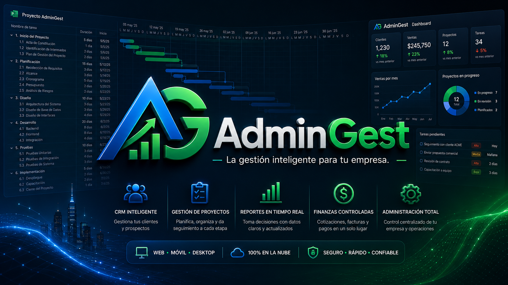
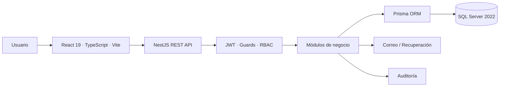
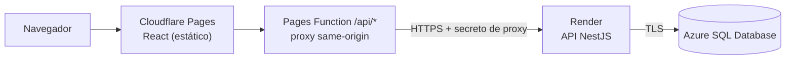

<p align="center">
  
</p>

<p align="center">
   
</p>

<p align="center">
  
  
  
</p>

<p align="center">
  <a href="https://github.com/Jairo0811/AdminGest/actions/workflows/ci.yml">
    
  </a>
</p>

<p align="center">
  <strong>CRM, proyectos, cotizaciones y gestión empresarial multiempresa con sesiones seguras y automatizaciones.</strong>
</p>

<p align="center">
  React · NestJS · Prisma · SQL Server · Docker · GitHub Actions · Cloudflare Pages
</p>

## 📘 Descripción

**AdminGest** es una plataforma web multiempresa orientada a la gestión comercial, administrativa y de proyectos. Centraliza prospectos, clientes, oportunidades, actividades, cotizaciones, reportes, usuarios, roles y proyectos en una sola solución moderna.

El proyecto reconstruye de forma independiente el trabajo final académico **GestorAdministrativo**, desarrollado para la asignatura **Administración de Proyectos de Software (SOF-013)** del Instituto Tecnológico de Las Américas (ITLA), período **2018-C3**.

## ✨ Funcionalidades principales

- CRM multiempresa con prospectos, clientes, oportunidades, actividades y pipeline comercial.
- Cotizaciones con numeración por empresa, descuento proporcional, ITBIS por línea (18 % o exento), QR y verificación pública. Son propuestas comerciales, no facturas ni comprobantes fiscales.
- Proyectos, tareas, cronograma, importación/exportación CSV y compatibilidad con Microsoft Project.
- Dashboard ejecutivo, reportes, exportaciones y diseño responsive.
- Gestión de usuarios, roles y permisos con RBAC.
- Perfil, recuperación y cambio seguro de contraseña.
- Validación dominicana de cédula y RNC.
- Planes SaaS con prueba gratuita y cuotas de usuarios, clientes y proyectos aplicadas de forma atómica.
- Notificaciones internas, reglas de automatización, plantillas de tareas y registro de documentos externos.
- Accesibilidad con objetivo WCAG 2.2 AA y NORTIC B2:2017, verificada con axe-core (sin certificación).

## 🛡️ Seguridad

AdminGest incorpora tokens de acceso de 15 minutos en memoria, refresh tokens rotativos en cookie HttpOnly, sesiones revocables por dispositivo, contraseñas con bcrypt, autorización basada en roles, aislamiento multiempresa validado en la API y reforzado con claves foráneas compuestas en SQL Server, impresión protegida contra XSS, recuperación de contraseña con tokens de un solo uso, rate limiting, Helmet, CORS configurable, validación estricta de DTO, auditoría de operaciones sensibles y gestión de secretos mediante variables de entorno.

La API es la fuente de verdad de autorización. Aunque la interfaz oculte una acción, el backend vuelve a validar el rol, recurso y tipo de operación antes de procesarla.

Consulta [SECURITY.md](SECURITY.md) y la [matriz RBAC](docs/security/rbac-matrix.md) para la documentación completa.

## 🧱 Stack tecnológico

### ⚛️ Frontend

<p>
  
</p>

- React 19
- TypeScript
- Vite
- React Router
- TanStack Query
- Vitest
- Testing Library

### ⚙️ Backend

<p>
  
</p>

- Node.js
- NestJS 11
- Passport
- JWT
- Swagger/OpenAPI
- Jest

### 🗄️ Base de datos y persistencia

<p>
  
  
</p>

- Microsoft SQL Server 2022
- Prisma ORM 6
- Migraciones versionadas
- Modelo relacional multiempresa

### 🧪 Calidad, automatización e infraestructura

<p>
  
</p>

<p>
  
  
  
  
</p>

- npm workspaces
- ESLint
- Prettier
- Jest
- Vitest
- GitHub Actions
- Docker Compose

## 🏗️ Arquitectura



Arquitectura de despliegue en la nube (preparada; ver [estado](#-estado-del-producto-v120)):



Consulta [docs/ARCHITECTURE.md](docs/ARCHITECTURE.md) para la documentación arquitectónica completa.

## 📋 Requisitos

- Git
- Node.js 24 (versión de `.nvmrc`, `.node-version` y CI; mínimo admitido: 22)
- npm compatible con el `package-lock.json`
- SQL Server Express 2022 recomendado para desarrollo local
- Docker Desktop opcional

## 🚀 Instalación local

```bash
git clone https://github.com/Jairo0811/AdminGest.git
cd AdminGest
npm ci
```

Prepara los archivos de entorno a partir de los ejemplos y define tus propios valores:

```bash
cp .env.example .env                    # MSSQL_SA_PASSWORD para Docker
cp apps/api/.env.example apps/api/.env  # DATABASE_URL, JWT_SECRET, SEED_ADMIN_PASSWORD…
cp apps/web/.env.example apps/web/.env  # VITE_API_URL=/api usa el proxy de Vite
```

Levanta SQL Server (o usa una instancia local de SQL Server 2022), crea la base `AdminGestDb` y ejecuta:

```bash
docker compose up -d                    # opcional
npm run db:generate
npm run db:deploy                       # aplica las migraciones versionadas
npm run db:seed                         # planes y datos de demostración (solo fuera de producción)
npm run dev
```

`db:migrate` (`prisma migrate dev`) queda reservado para crear migraciones nuevas durante el desarrollo.

### 📱 Acceso desde un móvil en la red local

En desarrollo, el frontend Vite escucha en `0.0.0.0:5173` y reenvía las peticiones `/api` al backend NestJS local. Esto evita configurar la IP de la API en el teléfono.

Con la PC y el móvil conectados a la misma red:

1. Ejecuta `npm run dev`.
2. Obtén la IPv4 de la PC con `ipconfig`.
3. Abre desde el navegador del móvil:

```text
http://<IP-DE-LA-PC>:5173
```

Ejemplo:

```text
http://192.168.1.50:5173
```

El backend continúa disponible localmente en el puerto `3000`. Si Windows solicita permiso de firewall para Node.js, permite únicamente redes privadas.

## 🔑 Credenciales de demostración

| Campo          | Valor                                                                                           |
| -------------- | ----------------------------------------------------------------------------------------------- |
| **Correo**     | `admin@admingest.com.do`                                                                        |
| **Contraseña** | La definida en `SEED_ADMIN_PASSWORD`; si no se define, el seed genera una y la muestra una vez. |

> El repositorio no contiene contraseñas reales. Ejecutar el seed de nuevo **no** modifica un
> administrador existente; para restablecer su contraseña fuera de producción usa
> `SEED_RESET_ADMIN_PASSWORD=true` junto con `SEED_ADMIN_PASSWORD`.

## ✅ Validación técnica

```bash
npm ci
npm run db:generate
npm run db:validate
npm run format:check
npm run lint
npm run test
npm run build
npm run security:audit
npm run test:integration --workspace @admingest/api   # requiere SQL Server (ver docs/TESTING.md)
```

GitHub Actions ejecuta además, sobre SQL Server 2022 real: migraciones desde una base limpia, el seed dos
veces, pruebas de integración y E2E HTTP (aislamiento Empresa A / Empresa B, sesiones y concurrencia),
la actualización desde el esquema v1.1.0 con datos heredados, el arranque de la API desde el build y
pruebas E2E en navegador con Playwright.

## 📚 Documentación

- [Notas de la versión 1.2.0 y congelamiento](docs/RELEASE-1.2.0.md)
- [Arquitectura](docs/ARCHITECTURE.md)
- [Pruebas](docs/TESTING.md)
- [Accesibilidad](docs/ACCESSIBILITY.md)
- [Matriz RBAC](docs/security/rbac-matrix.md)
- [Despliegue (general)](docs/DEPLOYMENT.md)
- [Cloudflare Pages y proxy `/api/*`](docs/CLOUDFLARE.md)
- [API en Render](docs/RENDER.md)
- [Base de datos en Azure SQL](docs/AZURE-SQL.md)
- [Variables de entorno](docs/ENVIRONMENT.md)
- [Lista de verificación de producción](docs/PRODUCTION-CHECKLIST.md)
- [Seguridad en producción](docs/PRODUCTION-SECURITY.md)
- [Base SaaS](docs/SAAS-FOUNDATION.md)
- [Automatización de negocio](docs/BUSINESS-AUTOMATION.md)
- [Recuperación de contraseña](docs/RC3.2-PASSWORD-RECOVERY.md)
- [Política de seguridad](SECURITY.md)
- [Componentes de terceros](THIRD_PARTY_NOTICES.md)
- [Historial de cambios](CHANGELOG.md)

## 🎓 Información académica

| Información          | Detalle                                               |
| -------------------- | ----------------------------------------------------- |
| 📖 Asignatura        | **Administración de Proyectos de Software (SOF-013)** |
| 👨‍🏫 Profesor          | **Juan Martínez López**                               |
| 🏫 Institución       | **Instituto Tecnológico de Las Américas (ITLA)**      |
| 📅 Período académico | **2018-C3**                                           |
| 📁 Tipo de entrega   | **Proyecto Final**                                    |

### 👥 Equipo académico original

| 👤 Integrante                       | 🆔 Matrícula |
| ----------------------------------- | ------------ |
| 👨🏻‍💻 Francis Jairo Matías Rosario     | 2015-2984    |
| 👨🏻‍💻 Isaías Pérez Moya                | 2016-3595    |
| 👨🏻‍💻 Enmanuel Avilez Valoy            | 2016-3789    |
| 👩🏻‍💻 Diana Caroline Mejía Encarnación | 2016-3796    |
| 👨🏻‍💻 Andrés Eudoro Pujols             | 2016-3917    |
| 👨🏻‍💻 Alexander Dionicio Mercedes      | 2016-3962    |
| 👨🏻‍💻 Raymundo Eduardo Peña Sánchez    | 2016-4276    |

## 🧭 Continuidad académica

AdminGest forma parte de **dos líneas académicas verificables** dentro de la trayectoria del ITLA. Una corresponde a continuidad docente y la otra a una compañera recurrente. Se documentan de forma separada porque representan relaciones diferentes.

### 👨‍🏫 Continuidad por profesor

El profesor **Juan Martínez López** aparece en dos proyectos académicos de la colección:

| Orden | Proyecto académico original | Evolución actual                                                 | Asignatura                                        | Período |
| ----: | --------------------------- | ---------------------------------------------------------------- | ------------------------------------------------- | ------- |
|     1 | RadioEmisora                | [**RadioEmisora RD**](https://github.com/Jairo0811/RadioEmisora) | Diseño Centrado en el Usuario (SOF-010)           | 2018-C1 |
|     2 | GestorAdministrativo        | **AdminGest**                                                    | Administración de Proyectos de Software (SOF-013) | 2018-C3 |

La primera etapa estuvo enfocada en interacción, usabilidad y experiencia de usuario; la segunda amplió la formación hacia planificación, organización y gestión integral de proyectos de software.

### 👥 Continuidad por estudiante

**Diana Caroline Mejía Encarnación (2016-3796)** coincidió con Francis Jairo Matías Rosario en dos proyectos académicos consecutivos durante 2018:

| Orden | Asignatura                                        | Proyecto actual                                                | Período |
| ----: | ------------------------------------------------- | -------------------------------------------------------------- | ------- |
|     1 | Programación 3 (SOF-005)                          | [**GamePoint POS**](https://github.com/Jairo0811/GamePointPOS) | 2018-C2 |
|     2 | Administración de Proyectos de Software (SOF-013) | **AdminGest**                                                  | 2018-C3 |

La recurrencia queda respaldada por el mismo **nombre completo y matrícula** en los equipos académicos originales de ambos repositorios.

Vistas en conjunto, estas relaciones permiten observar una trayectoria que combina **experiencia de usuario**, **programación aplicada** y **gestión de proyectos de software**, sin presentar los sistemas como dependencias técnicas ni como secuelas funcionales.

## 📄 Licencia

El repositorio todavía no incluye un archivo de licencia. Mientras el propietario no defina una, se
aplican por defecto todos los derechos reservados. Los componentes de terceros se detallan en
[THIRD_PARTY_NOTICES.md](THIRD_PARTY_NOTICES.md).

## 🧊 Estado del producto (v1.2.0)

Las fases comerciales se desarrollaron de forma independiente de la reconstrucción académica:

- [Fase 1 — SaaS Foundation](docs/SAAS-FOUNDATION.md)
- [Fase 2 — Production Security](docs/PRODUCTION-SECURITY.md)
- [Fase 3 — Business Automation](docs/BUSINESS-AUTOMATION.md)
- [Hardening final y congelamiento v1.2.0](docs/RELEASE-1.2.0.md)

### ✅ Funcionalidad implementada

Verificada con pruebas automatizadas en CI sobre SQL Server 2022 real (integración HTTP y Playwright):

- CRM, cotizaciones con ITBIS y verificación QR, proyectos, tareas, cronograma, reportes y exportaciones.
- Multiempresa con aislamiento en la API y claves foráneas compuestas; RBAC aplicado en la API.
- Sesiones con refresh rotativo en cookie HttpOnly, revocación por dispositivo y cierre global.
- Planes SaaS con cuotas de usuarios, clientes y proyectos; notificaciones, automatizaciones, plantillas y
  registro de documentos externos.
- Frontend publicable en Cloudflare Pages con proxy `/api/*` (publicado en `admingest.pages.dev`).
- Estados de servicio diferenciados en la interfaz: API no configurada, servidor iniciando o caído, base de
  datos no disponible, sin conexión, sesión expirada, permisos y validación.
- Registro público configurable y aplicado por la API (`PUBLIC_REGISTRATION`).
- Acceso a la API restringido al proxy de Cloudflare e IP real del visitante (`API_PROXY_SECRET`).

### ⚙️ Funcionalidad pendiente de configuración

El código y las guías existen; falta infraestructura del propietario:

- API NestJS en Render ([guía](docs/RENDER.md), [`render.yaml`](render.yaml)).
- Base de datos Azure SQL, firewall, usuarios y migraciones ([guía](docs/AZURE-SQL.md)).
- `API_ORIGIN` y `API_PROXY_SECRET` en Cloudflare Pages ([guía](docs/CLOUDFLARE.md)). Hasta entonces
  `admingest.pages.dev` muestra la interfaz, pero **no permite iniciar sesión ni guardar datos**.
- Correo de recuperación con Resend y un dominio verificado; `DOCUMENT_ALLOWED_HOSTS`.
- Verificación de extremo a extremo en producción ([lista](docs/PRODUCTION-CHECKLIST.md)): **pendiente**.

### ⛔ Funcionalidad no implementada

- Cobros, suscripciones de pago y renovación automática (el plan lo asigna un operador).
- Autenticación multifactor (MFA).
- Almacenamiento privado de archivos (solo referencias HTTPS externas).
- Facturación electrónica (e-CF). **Las cotizaciones no son facturas ni comprobantes fiscales** y AdminGest
  no está autorizado por la DGII.
- Paginación del servidor (los listados se paginan en el cliente).
- Worker o cola persistente para recordatorios (se ejecutan dentro del proceso de la API).
- Capacidades informativas de los planes: cuota de almacenamiento, reportes avanzados y acceso API.
- Monitoreo, alertas y respaldos operados; licencia del repositorio.

### 🔭 Propuesta futura

Ver el [Roadmap](#roadmap--evolución-futura-de-admingest) al final de este documento.

### 🧊 Niveles de congelamiento

| Nivel                                       | Significado                                                                                                   | Estado v1.2.0                                                                              |
| ------------------------------------------- | ------------------------------------------------------------------------------------------------------------- | ------------------------------------------------------------------------------------------ |
| **1. Código estable**                       | Compilación, pruebas y correcciones técnicas verificadas.                                                     | **Alcanzado.** PR #33, #34 y #35 fusionados en `main` con CI verde.                        |
| **2. Despliegue funcional**                 | Frontend, backend, base de datos y servicios conectados y probados.                                           | **No alcanzado.** Render y Azure SQL sin configurar; verificación de producción pendiente. |
| **3. Producto listo para comercialización** | Además: cobros, soporte, operación, protección de datos, requisitos legales y fiscales, monitoreo y respaldo. | **No alcanzado.**                                                                          |

Alcanzar un nivel no implica los siguientes. Procedimiento: [RELEASE-1.2.0.md](docs/RELEASE-1.2.0.md).

## ☁️ Despliegue en la nube

```text
Navegador → Cloudflare Pages → Pages Function /api/* → Render (NestJS) → Azure SQL Database
```

1. **Azure SQL:** crear la base, usuarios con privilegios mínimos, firewall y migraciones —
   [AZURE-SQL.md](docs/AZURE-SQL.md).
2. **Render:** crear el servicio desde `render.yaml` y definir las variables secretas —
   [RENDER.md](docs/RENDER.md).
3. **Cloudflare Pages:** definir `API_ORIGIN` y `API_PROXY_SECRET` y redesplegar —
   [CLOUDFLARE.md](docs/CLOUDFLARE.md).
4. **Verificar:** [PRODUCTION-CHECKLIST.md](docs/PRODUCTION-CHECKLIST.md).

Con los planes gratuitos, la API se suspende tras 15 minutos sin tráfico y tarda alrededor de un minuto en
responder de nuevo; la interfaz lo indica. Ningún secreto se define en variables `VITE_*`
([ENVIRONMENT.md](docs/ENVIRONMENT.md)).

# Roadmap — Evolución futura de AdminGest

Esta sección recoge el potencial de evolución de AdminGest como plataforma SaaS comercial. **No es una
promesa de lanzamiento ni describe funcionalidades implementadas.** Las versiones indicadas son
**tentativas** y no hay fechas comprometidas.

| Iniciativa                                          | Prioridad | Estado                    | Dependencias                                                              | Versión futura       |
| --------------------------------------------------- | --------- | ------------------------- | ------------------------------------------------------------------------- | -------------------- |
| A.1 Infraestructura productiva                      | Alta      | Parcialmente implementado | Cuentas Render/Azure; autorización de costos                              | v1.2.x (tentativa)   |
| A.2 Paginación del servidor                         | Alta      | Pendiente                 | Cambios de API e índices                                                  | v1.3 (tentativa)     |
| A.3 Automatizaciones persistentes                   | Alta      | Parcialmente implementado | A.1; worker y cola (posible plan de pago)                                 | v1.3 (tentativa)     |
| B.1 Autenticación multifactor                       | Alta      | Pendiente                 | Diseño de recuperación de acceso; auditoría                               | v1.4 (tentativa)     |
| B.2 Seguridad avanzada                              | Media     | Parcialmente implementado | A.1 (monitoreo y alertas)                                                 | v1.4 (tentativa)     |
| B.3 Actualización tecnológica (NestJS 12, Prisma 7) | Media     | En evaluación             | Compatibilidad de migraciones; avisos de `npm audit`                      | v2.0 (tentativa)     |
| C.1 Almacenamiento privado de archivos              | Media     | Pendiente                 | Proveedor (R2 o Azure Blob); costos                                       | v1.4 (tentativa)     |
| C.2 Capacidades reales de planes SaaS               | Media     | Parcialmente implementado | C.1; reglas de downgrade                                                  | v1.4 (tentativa)     |
| D.1 Cobros                                          | Media     | En evaluación             | Evaluación técnica, comercial y legal de pasarelas                        | v2.0 (tentativa)     |
| D.2 Suscripciones de pago                           | Media     | Pendiente                 | D.1                                                                       | v2.0 (tentativa)     |
| D.3 Administración comercial                        | Baja      | Fuera del alcance actual  | D.2                                                                       | v2.0 (tentativa)     |
| E. Facturación electrónica DGII (e-CF)              | Baja      | Fuera del alcance actual  | Requisitos oficiales vigentes; certificado digital o proveedor autorizado | Sin versión asignada |

## Etapa A — Estabilidad y operación

**Prioridad alta para cualquier despliegue operativo.**

- **A.1 Infraestructura productiva.** Backend disponible permanentemente o con disponibilidad claramente
  definida, base de datos persistente, HTTPS, gestión segura de variables, procedimiento de despliegue,
  entornos separados, registro de errores, respaldos, restauraciones verificadas, monitoreo y alertas.
  _Hecho en v1.2.0:_ guías de [Cloudflare](docs/CLOUDFLARE.md), [Render](docs/RENDER.md) y
  [Azure SQL](docs/AZURE-SQL.md), health checks de liveness y readiness, proxy con secreto y estados de
  servicio en la interfaz.
- **A.2 Paginación del servidor.** Paginación desde la API, filtros y ordenamiento en el servidor,
  búsquedas eficientes, índices apropiados y consultas optimizadas.
- **A.3 Automatizaciones persistentes.** Sustituir los recordatorios ligados al proceso de la API por un
  worker independiente con cola persistente, reintentos controlados, registro de ejecuciones, idempotencia,
  manejo de fallos y observabilidad ([estado actual](docs/BUSINESS-AUTOMATION.md)).

## Etapa B — Seguridad empresarial

- **B.1 Autenticación multifactor.** TOTP, códigos de recuperación, dispositivos confiables, recuperación de
  acceso, revocación y auditoría de eventos. Sin implementaciones parciales o improvisadas.
- **B.2 Seguridad avanzada.** Alertas de inicio de sesión, detección de actividad sospechosa, auditoría
  administrativa, revisión de permisos, políticas de sesión, observabilidad, gestión de incidentes y una
  Content-Security-Policy para la aplicación principal ([seguridad](docs/PRODUCTION-SECURITY.md)).
- **B.3 Actualización tecnológica.** NestJS 12, Prisma 7, dependencias, compatibilidad de migraciones,
  vulnerabilidades pendientes ([avisos aceptados](SECURITY.md#avisos-aceptados-en-v120)) y rendimiento.
  No se actualizan versiones mayores durante el congelamiento.

## Etapa C — Documentos y gestión empresarial

- **C.1 Almacenamiento privado de archivos.** Hoy solo se registran referencias HTTPS externas. Evaluar
  Cloudflare R2 o Azure Blob Storage con URLs firmadas, control de permisos, cifrado, límites por empresa,
  validación de archivos, auditoría y políticas de retención.
- **C.2 Capacidades reales de planes SaaS.** Aplicar técnicamente la cuota de almacenamiento, los reportes
  avanzados, el acceso API, las funciones por plan, las restricciones de consumo, los cambios de plan, el
  downgrade y el comportamiento al alcanzar límites ([base SaaS](docs/SAAS-FOUNDATION.md)). No se anuncian
  como operativas mientras no lo estén.

## Etapa D — Monetización SaaS

- **D.1 Cobros.** Evaluar pasarelas compatibles con República Dominicana y el mercado objetivo: costos de
  transacción, métodos de pago, comisiones, seguridad, conciliación, reembolsos, webhooks y gestión de
  errores. No se selecciona una pasarela sin evaluación técnica y comercial.
- **D.2 Suscripciones de pago.** Activación de planes, renovación automática, cambios de plan,
  cancelaciones, períodos de gracia, historial de cobros, estados de facturación, notificaciones de
  vencimiento y pagos fallidos.
- **D.3 Administración comercial.** Gestión de clientes SaaS, indicadores de suscripciones, ingresos
  recurrentes, cancelaciones, consumo por plan y panel comercial.

## Etapa E — Facturación electrónica dominicana

Evaluar la integración con el sistema de comprobantes fiscales electrónicos (e-CF) de la DGII si el alcance
comercial lo requiere. Antes de desarrollar: investigar los requisitos oficiales vigentes y el procedimiento
de habilitación, decidir entre emisor directo o proveedor autorizado, evaluar certificados y firmas
digitales, definir validaciones, estados y respuestas de comprobantes, anulaciones y contingencias, y diseñar
la auditoría y el almacenamiento fiscal. Requiere una fase independiente.

> **Importante:** las cotizaciones actuales **no son facturas electrónicas** ni comprobantes fiscales.
> AdminGest no cuenta con certificación ni autorización de la DGII.
