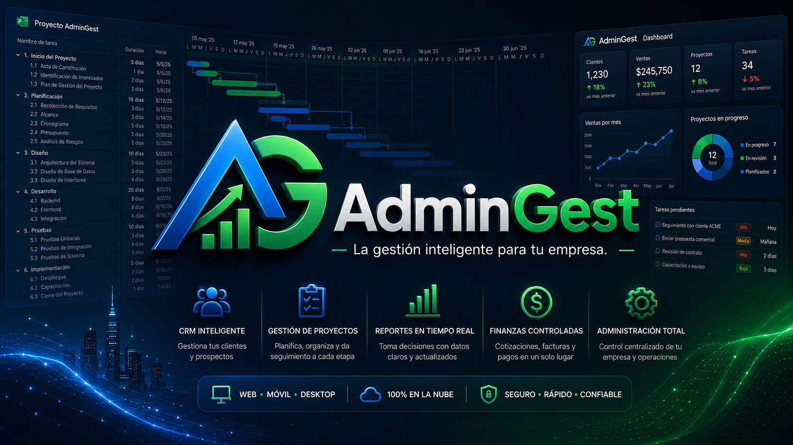
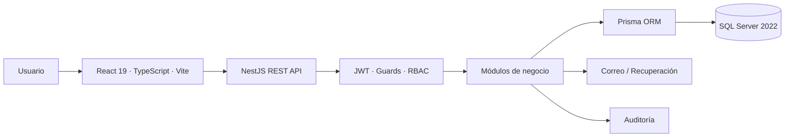

<p align="center">
  
</p>

<p align="center">
   
</p>

<p align="center">
  
  
  
</p>

<p align="center">
  <a href="https://github.com/Jairo0811/AdminGest/actions/workflows/ci.yml">
    
  </a>
</p>

<p align="center">
  <strong>CRM, proyectos, cotizaciones y gestión empresarial multiempresa con sesiones seguras y automatizaciones.</strong>
</p>

<p align="center">
  React · NestJS · Prisma · SQL Server · Docker · GitHub Actions
</p>

## 📘 Descripción

**AdminGest** es una plataforma web multiempresa orientada a la gestión comercial, administrativa y de proyectos. Centraliza prospectos, clientes, oportunidades, actividades, cotizaciones, reportes, usuarios, roles y proyectos en una sola solución moderna.

El proyecto reconstruye de forma independiente el trabajo final académico **GestorAdministrativo**, desarrollado para la asignatura **Administración de Proyectos de Software (SOF-013)** del Instituto Tecnológico de Las Américas (ITLA), período **2018-C3**.

## ✨ Funcionalidades principales

- CRM multiempresa con prospectos, clientes, oportunidades, actividades y pipeline comercial.
- Cotizaciones con numeración por empresa, descuento proporcional, ITBIS por línea (18 % o exento), QR y verificación pública. Son propuestas comerciales, no facturas ni comprobantes fiscales.
- Proyectos, tareas, cronograma, importación/exportación CSV y compatibilidad con Microsoft Project.
- Dashboard ejecutivo, reportes, exportaciones y diseño responsive.
- Gestión de usuarios, roles y permisos con RBAC.
- Perfil, recuperación y cambio seguro de contraseña.
- Validación dominicana de cédula y RNC.
- Planes SaaS con prueba gratuita y cuotas de usuarios, clientes y proyectos aplicadas de forma atómica.
- Notificaciones internas, reglas de automatización, plantillas de tareas y registro de documentos externos.
- Accesibilidad con objetivo WCAG 2.2 AA y NORTIC B2:2017, verificada con axe-core (sin certificación).

## 🛡️ Seguridad

AdminGest incorpora tokens de acceso de 15 minutos en memoria, refresh tokens rotativos en cookie HttpOnly, sesiones revocables por dispositivo, contraseñas con bcrypt, autorización basada en roles, aislamiento multiempresa validado en la API y reforzado con claves foráneas compuestas en SQL Server, impresión protegida contra XSS, recuperación de contraseña con tokens de un solo uso, rate limiting, Helmet, CORS configurable, validación estricta de DTO, auditoría de operaciones sensibles y gestión de secretos mediante variables de entorno.

La API es la fuente de verdad de autorización. Aunque la interfaz oculte una acción, el backend vuelve a validar el rol, recurso y tipo de operación antes de procesarla.

Consulta [SECURITY.md](SECURITY.md) y la [matriz RBAC](docs/security/rbac-matrix.md) para la documentación completa.

## 🧱 Stack tecnológico

### ⚛️ Frontend

<p>
  
</p>

- React 19
- TypeScript
- Vite
- React Router
- TanStack Query
- Vitest
- Testing Library

### ⚙️ Backend

<p>
  
</p>

- Node.js
- NestJS 11
- Passport
- JWT
- Swagger/OpenAPI
- Jest

### 🗄️ Base de datos y persistencia

<p>
  
  
</p>

- Microsoft SQL Server 2022
- Prisma ORM 6
- Migraciones versionadas
- Modelo relacional multiempresa

### 🧪 Calidad, automatización e infraestructura

<p>
  
</p>

<p>
  
  
  
  
</p>

- npm workspaces
- ESLint
- Prettier
- Jest
- Vitest
- GitHub Actions
- Docker Compose

## 🏗️ Arquitectura



Consulta [docs/ARCHITECTURE.md](docs/ARCHITECTURE.md) para la documentación arquitectónica completa.

## 📋 Requisitos

- Git
- Node.js 22 o superior
- npm compatible con el `package-lock.json`
- SQL Server Express 2022 recomendado para desarrollo local
- Docker Desktop opcional

## 🚀 Instalación local

```bash
git clone https://github.com/Jairo0811/AdminGest.git
cd AdminGest
npm ci
```

Prepara los archivos de entorno a partir de los ejemplos y define tus propios valores:

```bash
cp .env.example .env                    # MSSQL_SA_PASSWORD para Docker
cp apps/api/.env.example apps/api/.env  # DATABASE_URL, JWT_SECRET, SEED_ADMIN_PASSWORD…
cp apps/web/.env.example apps/web/.env  # VITE_API_URL=/api usa el proxy de Vite
```

Levanta SQL Server (o usa una instancia local de SQL Server 2022), crea la base `AdminGestDb` y ejecuta:

```bash
docker compose up -d                    # opcional
npm run db:generate
npm run db:deploy                       # aplica las migraciones versionadas
npm run db:seed                         # planes y datos de demostración (solo fuera de producción)
npm run dev
```

`db:migrate` (`prisma migrate dev`) queda reservado para crear migraciones nuevas durante el desarrollo.

### 📱 Acceso desde un móvil en la red local

En desarrollo, el frontend Vite escucha en `0.0.0.0:5173` y reenvía las peticiones `/api` al backend NestJS local. Esto evita configurar la IP de la API en el teléfono.

Con la PC y el móvil conectados a la misma red:

1. Ejecuta `npm run dev`.
2. Obtén la IPv4 de la PC con `ipconfig`.
3. Abre desde el navegador del móvil:

```text
http://<IP-DE-LA-PC>:5173
```

Ejemplo:

```text
http://192.168.1.50:5173
```

El backend continúa disponible localmente en el puerto `3000`. Si Windows solicita permiso de firewall para Node.js, permite únicamente redes privadas.

## 🔑 Credenciales de demostración

| Campo          | Valor                                                                                           |
| -------------- | ----------------------------------------------------------------------------------------------- |
| **Correo**     | `admin@admingest.com.do`                                                                        |
| **Contraseña** | La definida en `SEED_ADMIN_PASSWORD`; si no se define, el seed genera una y la muestra una vez. |

> El repositorio no contiene contraseñas reales. Ejecutar el seed de nuevo **no** modifica un
> administrador existente; para restablecer su contraseña fuera de producción usa
> `SEED_RESET_ADMIN_PASSWORD=true` junto con `SEED_ADMIN_PASSWORD`.

## ✅ Validación técnica

```bash
npm ci
npm run db:generate
npm run db:validate
npm run format:check
npm run lint
npm run test
npm run build
npm run security:audit
npm run test:integration --workspace @admingest/api   # requiere SQL Server (ver docs/TESTING.md)
```

GitHub Actions ejecuta además, sobre SQL Server 2022 real: migraciones desde una base limpia, el seed dos
veces, pruebas de integración y E2E HTTP (aislamiento Empresa A / Empresa B, sesiones y concurrencia),
la actualización desde el esquema v1.1.0 con datos heredados, el arranque de la API desde el build y
pruebas E2E en navegador con Playwright.

## 📚 Documentación

- [Notas de la versión 1.2.0 y congelamiento](docs/RELEASE-1.2.0.md)
- [Arquitectura](docs/ARCHITECTURE.md)
- [Pruebas](docs/TESTING.md)
- [Accesibilidad](docs/ACCESSIBILITY.md)
- [Matriz RBAC](docs/security/rbac-matrix.md)
- [Despliegue](docs/DEPLOYMENT.md)
- [Seguridad en producción](docs/PRODUCTION-SECURITY.md)
- [Base SaaS](docs/SAAS-FOUNDATION.md)
- [Automatización de negocio](docs/BUSINESS-AUTOMATION.md)
- [Recuperación de contraseña](docs/RC3.2-PASSWORD-RECOVERY.md)
- [Política de seguridad](SECURITY.md)
- [Componentes de terceros](THIRD_PARTY_NOTICES.md)
- [Historial de cambios](CHANGELOG.md)

## 🎓 Información académica

| Información          | Detalle                                               |
| -------------------- | ----------------------------------------------------- |
| 📖 Asignatura        | **Administración de Proyectos de Software (SOF-013)** |
| 👨‍🏫 Profesor          | **Juan Martínez López**                               |
| 🏫 Institución       | **Instituto Tecnológico de Las Américas (ITLA)**      |
| 📅 Período académico | **2018-C3**                                           |
| 📁 Tipo de entrega   | **Proyecto Final**                                    |

### 👥 Equipo académico original

| 👤 Integrante                       | 🆔 Matrícula |
| ----------------------------------- | ------------ |
| 👨🏻‍💻 Francis Jairo Matías Rosario     | 2015-2984    |
| 👨🏻‍💻 Isaías Pérez Moya                | 2016-3595    |
| 👨🏻‍💻 Enmanuel Avilez Valoy            | 2016-3789    |
| 👩🏻‍💻 Diana Caroline Mejía Encarnación | 2016-3796    |
| 👨🏻‍💻 Andrés Eudoro Pujols             | 2016-3917    |
| 👨🏻‍💻 Alexander Dionicio Mercedes      | 2016-3962    |
| 👨🏻‍💻 Raymundo Eduardo Peña Sánchez    | 2016-4276    |

## 🧭 Continuidad académica

AdminGest forma parte de **dos líneas académicas verificables** dentro de la trayectoria del ITLA. Una corresponde a continuidad docente y la otra a una compañera recurrente. Se documentan de forma separada porque representan relaciones diferentes.

### 👨‍🏫 Continuidad por profesor

El profesor **Juan Martínez López** aparece en dos proyectos académicos de la colección:

| Orden | Proyecto académico original | Evolución actual                                                 | Asignatura                                        | Período |
| ----: | --------------------------- | ---------------------------------------------------------------- | ------------------------------------------------- | ------- |
|     1 | RadioEmisora                | [**RadioEmisora RD**](https://github.com/Jairo0811/RadioEmisora) | Diseño Centrado en el Usuario (SOF-010)           | 2018-C1 |
|     2 | GestorAdministrativo        | **AdminGest**                                                    | Administración de Proyectos de Software (SOF-013) | 2018-C3 |

La primera etapa estuvo enfocada en interacción, usabilidad y experiencia de usuario; la segunda amplió la formación hacia planificación, organización y gestión integral de proyectos de software.

### 👥 Continuidad por estudiante

**Diana Caroline Mejía Encarnación (2016-3796)** coincidió con Francis Jairo Matías Rosario en dos proyectos académicos consecutivos durante 2018:

| Orden | Asignatura                                        | Proyecto actual                                                | Período |
| ----: | ------------------------------------------------- | -------------------------------------------------------------- | ------- |
|     1 | Programación 3 (SOF-005)                          | [**GamePoint POS**](https://github.com/Jairo0811/GamePointPOS) | 2018-C2 |
|     2 | Administración de Proyectos de Software (SOF-013) | **AdminGest**                                                  | 2018-C3 |

La recurrencia queda respaldada por el mismo **nombre completo y matrícula** en los equipos académicos originales de ambos repositorios.

Vistas en conjunto, estas relaciones permiten observar una trayectoria que combina **experiencia de usuario**, **programación aplicada** y **gestión de proyectos de software**, sin presentar los sistemas como dependencias técnicas ni como secuelas funcionales.

## 📄 Licencia

El repositorio todavía no incluye un archivo de licencia. Mientras el propietario no defina una, se
aplican por defecto todos los derechos reservados. Los componentes de terceros se detallan en
[THIRD_PARTY_NOTICES.md](THIRD_PARTY_NOTICES.md).

## 🧊 Estado del producto (v1.2.0)

Las fases comerciales se desarrollaron de forma independiente de la reconstrucción académica y están
integradas en `main`:

- [Fase 1 — SaaS Foundation](docs/SAAS-FOUNDATION.md)
- [Fase 2 — Production Security](docs/PRODUCTION-SECURITY.md)
- [Fase 3 — Business Automation](docs/BUSINESS-AUTOMATION.md)
- [Hardening final y congelamiento v1.2.0](docs/RELEASE-1.2.0.md)

AdminGest v1.2.0 está **congelado técnicamente**: funcionalidades definidas, pruebas y documentación
alineadas con el código. **No está listo para comercialización**: no integra cobros ni renovación
automática, MFA, almacenamiento privado de archivos, facturación electrónica (e-CF) ni operación
productiva con respaldos y monitoreo. Las cotizaciones no son comprobantes fiscales.
